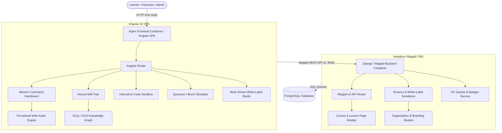

# ⚡ Synapse LMS: Technical Design Document

> **Document Version**: 1.0.0  
> **Status**: Approved & Production Ready  
> **Architecture**: Decoupled Headless Wagtail CMS + Angular Reactive SPA with Cyberpunk Gamification  
> **Author**: Abhijeet Raut ([@arauthub](https://github.com/arauthub))  

---

## 1. Executive Summary & Architectural Goals

**Synapse LMS** is a next-generation, cybernetic Learning Management System engineered to transform passive video/reading courses into an active, immersive, and gamified experience.

Key system objectives:
1. **Headless Wagtail CMS Backend**: Content modeling using Wagtail page trees, streamfields, and Wagtail v2 REST API router, decoupling content curation from presentation.
2. **Angular Reactive Client Architecture**: Modern single-page application using Angular, TypeScript, RxJS, and dynamic cyberpunk neon design tokens.
3. **Procedural Web Audio Engine**: Zero-asset audio synthesis using native Web Audio API oscillators for low-latency interactive feedback (blips, chimes, leveling fanfare).
4. **Interactive Simulators & Code Labs**: In-browser Canvas-based quantum/algorithmic simulators and live JavaScript/Python code sandboxes with test runner evaluation.
5. **Enterprise Multi-Tenancy**: White-label organization support with custom neon themes, domain routing, and modular gamification feature flags.

---

## 2. Technology Stack & Component Specifications

| Layer | Component | Specification | Rationale |
| :--- | :--- | :--- | :--- |
| **Backend CMS** | Wagtail CMS | 6.x / Django 5.x | Hierarchical content tree, StreamField modular blocks, and Wagtail v2 REST API. |
| **Backend API** | Django REST Framework | 3.15+ | Serializers, authentication endpoints, and tenancy management. |
| **Backend Runtime** | Python | 3.11+ / 3.12+ | High reliability, async support, and modern standard library. |
| **Frontend Framework** | Angular | Angular 22 | Strict standalone components, Signals reactivity, and RxJS pipelines. |
| **Styling & HUD UI** | Tailwind CSS + Cyber HUD | Custom PostCSS | Dark-mode neon palettes, glassmorphism, glowing borders, and responsive grid. |
| **Audio Synthesis** | Web Audio API | Native W3C Standard | Procedural audio synthesis without external MP3/WAV assets. |
| **Database** | PostgreSQL | 15+ / 16+ | Enterprise relational ACID compliance, JSONB support for dynamic tenant profiles. |
| **Containerization** | Docker & Compose | Spec 3.8 | Multi-stage production builds for Nginx Alpine frontend and Gunicorn WSGI backend. |

---

## 3. System Architecture & Component Interaction

---

## 4. Multi-Tenancy & White-Label Architecture

Synapse LMS supports multi-tenant isolation through the `tenancy` Django application:
- **Organization Model**: Holds domain/subdomain mappings, branding configuration (neon primary, secondary, and accent colors), font choices, and logo assets.
- **Dynamic Configuration Endpoint**: `/api/v1/tenancy/current/` returns tenant branding tokens consumed by Angular CSS custom properties.
- **Feature Flags**: Tenants can independently toggle XP gamification, skill tree access, audio effects, and automated certificate generation.

---

## 5. Security & Verification

- **Presubmit Validation**: Enforces zero secret leaks, code linting, and design document compliance.
- **CORS Protection**: Explicit origin whitelist with credential isolation.
- **Input Sanitization**: Client-side code evaluation runs in sandboxed web workers to prevent prototype pollution or host access.
