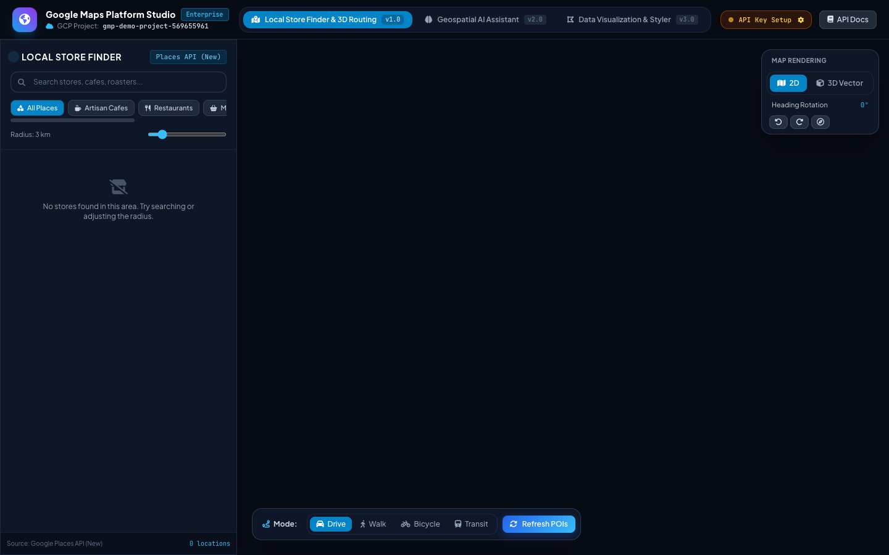
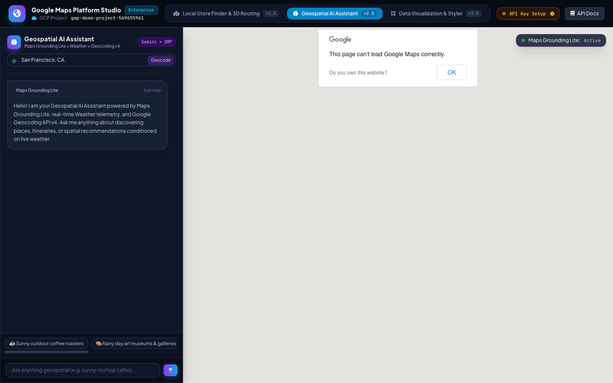
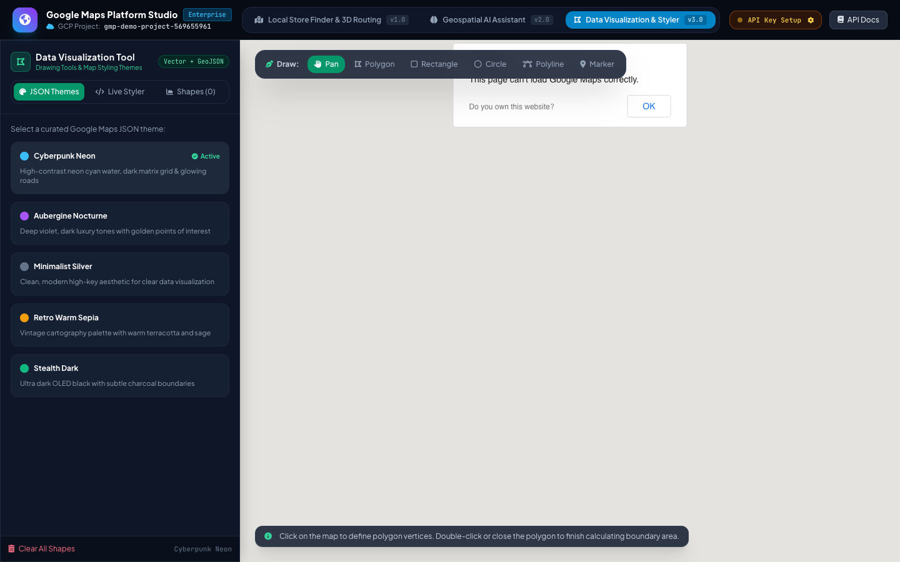

# 🗺️ Google Maps Platform Studio & Geospatial Intelligence Suite

An enterprise-grade, full-stack geospatial application demonstrating modern Google Maps Platform capabilities, advanced WebGL vector rendering, conversational Maps Grounding Lite with Gemini, real-time atmospheric intelligence, and vector boundary analytics.

- **Target GCP Project:** `gmp-demo-project-569655961`
- **Backend:** Python 3.11 + FastAPI + Pydantic v2 + Google GenAI SDK
- **Frontend:** Modern Angular 21 (Standalone Components) + Glassmorphic Cyber UI + Lucide/FontAwesome
- **Maps Engine:** Google Maps JavaScript API (Vector Maps, WebGL 3D, Advanced Markers, Drawing, Geometry)

---

## 🚀 The 3 Core Capabilities & Versions

### 📍 Version 1: Local Store Finder with 3D Routing

- **Map Rendering (2D / 3D Vector):** Real-time camera tilt (`0°` to `45°/60°`), heading rotation (`0°` to `360°`), and 3D architectural building footprints.
- **Advanced Markers & Interactive Events:** Custom DOM pin elements with pulse animations, rating pills, and event listeners (click, hover, focus).
- **Places API (New):** Integrated `places:searchNearby` and `places:searchText` with field mask optimization (`displayName`, `location`, `rating`, `openNow`, `priceLevel`, `primaryType`).
- **Compute Routes (Routes API):** Multi-modal route computation (`DRIVE`, `WALK`, `BICYCLE`, `TRANSIT`), polyline decoding, and turn-by-turn navigation drawer with distance and static duration.

### 🧠 Version 2: Geospatial AI Assistant

- **Maps Grounding Lite:** Injects real-time spatial context and retrieved POIs directly into Gemini prompt synthesis.
- **Geocoding API v4:** Natural language forward geocoding (address/city to coordinates) and reverse geocoding with bounding box centering.
- **Real-Time Weather Intelligence:** Atmospheric telemetry (temperature in °C, feels-like, wind speed km/h, humidity, UV index, and outdoor condition scoring) to reason about outdoor vs. indoor venue suitability.
- **Interactive Chat HUD:** Conversational suggestions synchronized with live map markers and popups.

### 🎨 Version 3: Spatial Data Visualization & Map Styler

- **Vector Drawing Tools:** Interactive drawing toolbar (`google.maps.drawing.DrawingManager`) supporting Polygons, Rectangles, Circles, Polylines, and Markers.
- **Boundary & Surface Analytics:** Real-time spherical surface area calculation (`m²`, `km²`, acres) via `google.maps.geometry.spherical.computeArea()` and perimeter length via `computeLength()`.
- **Map Styling Studio (Distinct JSON Themes):**
  - *Cyberpunk Neon* (High-contrast cyan water, dark matrix grid, magenta road vectors)
  - *Aubergine Nocturne* (Deep violet luxury cartography with golden POIs)
  - *Minimalist Silver* (Ultra-clean monochrome high-key aesthetic)
  - *Retro Warm Sepia* (Vintage cartography palette)
  - *Stealth Dark* (OLED pure black)
- **Live JSON Theme Editor & GeoJSON Export:** Edit raw MapStyle JSON in real time, apply live styles to the map canvas, and export drawn boundaries as standard GeoJSON files.

---

## 🏗️ Architecture & Project Structure

```
google_maps/
├── backend/
│   ├── app/
│   │   ├── core/config.py              # Environment configuration & dynamic key manager
│   │   ├── schemas/                    # Pydantic schemas (places, routes, weather, ai)
│   │   ├── services/
│   │   │   ├── places_service.py       # Google Places API (New) client & mock fallback
│   │   │   ├── routes_service.py       # Google Routes API (computeRoutes) & polyline decoder
│   │   │   ├── weather_service.py      # Real-time Weather telemetry (Open-Meteo & OpenWeather)
│   │   │   ├── geocoding_service.py    # Google Geocoding API v4 integration
│   │   │   └── ai_assistant_service.py # Gemini Maps Grounding Lite reasoning engine
│   │   ├── routers/                    # FastAPI REST endpoints
│   │   └── main.py                     # App factory & SPA static asset server
│   ├── requirements.txt
│   ├── Dockerfile
│   └── .env.example
├── frontend/
│   ├── src/
│   │   ├── app/
│   │   │   ├── components/
│   │   │   │   ├── store-finder/       # Version 1 Component
│   │   │   │   ├── geo-ai-assistant/   # Version 2 Component
│   │   │   │   ├── data-visualizer/    # Version 3 Component
│   │   │   │   └── api-key-modal/      # Dynamic runtime key modal
│   │   │   ├── services/               # Maps loader, API service, state
│   │   │   ├── models/                 # Map themes & TypeScript interfaces
│   │   │   ├── app.ts / app.html       # Shell UI & Version switcher
│   │   └── styles.css                  # Dark glassmorphic styling
│   ├── package.json
│   └── Dockerfile
├── deploy/
│   ├── deploy-cloudrun.sh              # Google Cloud Run deployment script
│   ├── docker-compose.yml              # Multi-container local runner
│   └── cloudbuild.yaml                 # GCP Cloud Build CI/CD config
├── Dockerfile                          # Unified multi-stage container
├── run.sh                              # One-command local runner
└── README.md
```

---

## ⚡ Quick Start

### Option A: One-Command Runner (Unified Service)
```bash
cd google_maps
./run.sh
```
- App UI: **http://localhost:8000**
- API Docs: **http://localhost:8000/docs**
- Health: **http://localhost:8000/health**

### Option B: Local Development Mode (Hot Reloading)

**Terminal 1 (Backend):**
```bash
cd google_maps/backend
source venv/bin/activate
uvicorn app.main:app --reload --port 8000
```

**Terminal 2 (Frontend):**
```bash
cd google_maps/frontend
npm start
```
Frontend runs at **http://localhost:4200** with hot reloading proxying to port `8000`.

---

## 🔑 API Keys & Permissions

When opening the app in your browser, click **"API Key Setup"** in the top navigation bar (or configure `.env` in `backend/.env`):

1. **Google Maps Platform API Key:**
   - Enable on GCP (`gmp-demo-project-569655961`):
     - `Maps JavaScript API`
     - `Places API (New)`
     - `Routes API`
     - `Geocoding API`
2. **Gemini API Key (Optional):**
   - For live conversational reasoning with Maps Grounding Lite.
3. *Note:* If keys are not immediately entered, the application automatically activates high-fidelity demo simulation mode so you can interact with all 3 versions right away.

---

## ☁️ Google Cloud Deployment (Cloud Run)

To deploy to Google Cloud Platform project `gmp-demo-project-569655961`:

```bash
cd google_maps/deploy
./deploy-cloudrun.sh
```

Or manually using Google Cloud SDK:
```bash
gcloud config set project gmp-demo-project-569655961

gcloud builds submit --tag gcr.io/gmp-demo-project-569655961/google-maps-suite:latest ..

gcloud run deploy google-maps-suite \
  --image gcr.io/gmp-demo-project-569655961/google-maps-suite:latest \
  --platform managed \
  --region us-central1 \
  --allow-unauthenticated \
  --project gmp-demo-project-569655961
```

